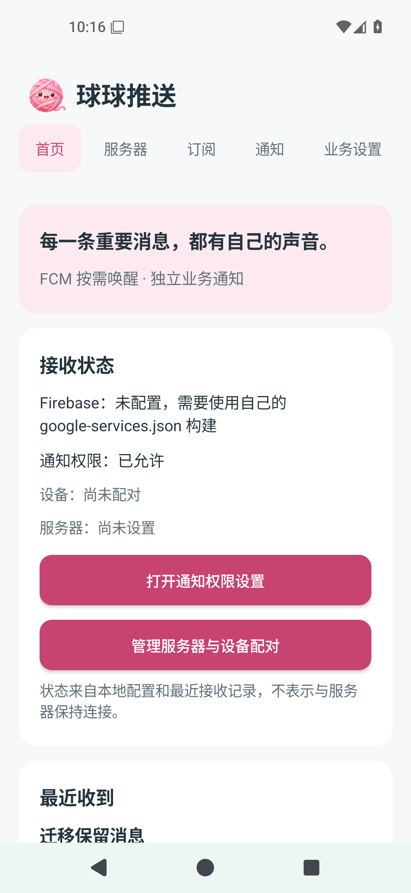

# 球球推送 · QiuQiu Push Android

[服务端与 Web 后台](https://github.com/dlaq/qiuqiu-push-server) · [上游升级流程](UPSTREAM_UPGRADE.md) · [真机验收](docs/device-acceptance.md)

本仓库 Fork 自 **binwiederhier/ntfy-android**。`main` 是球球推送客户端，保留ntfy上游历史，使用Kotlin、Play flavor和自有Firebase FCM。2.1默认FCM省电接收，另提供用户开启的后台直连/自动模式和真实接收回执；直连模式显示常驻通知。完整操作和兼容边界见[2.1升级说明](https://github.com/dlaq/qiuqiu-push-server/blob/main/qiuqiu/docs/upgrade-2.1.md)。

## 构建

JDK 17、Android SDK 36、Build Tools 36.0.0，使用仓库内 Gradle Wrapper 9.2.1。

1. 用自己的 Google 账号创建 Firebase 项目，注册包名 **`io.qiuqiu.push`**，将 Android 配置放到 `app/google-services.json`。Debug 包名是 `io.qiuqiu.push.debug`，测试 Debug FCM 时需匹配该注册包名。
2. 通过环境变量设置 `QQ_KEYSTORE_FILE`、`QQ_KEY_ALIAS`、`QQ_STORE_PASSWORD_FILE`、`QQ_KEY_PASSWORD_FILE`。密码变量是本地秘密文件的路径，不能将密码或私钥提交 Git。
3. 执行：

```sh
./gradlew :app:assemblePlayRelease :app:testFdroidDebugUnitTest :app:lintPlayRelease
python3 scripts/check-background-policy.py
```

只有检查界面时，可以显式增加 `-PqiuqiuAllowUnconfiguredFirebase=true` 构建未配置 Firebase 的 APK。此构建不代表 FCM 可用；正常 Release 构建默认拒绝缺少 Firebase 配置。产物在 `app/build/outputs/apk/play/release/`。

## 使用与状态

APP 的服务器页填写自己的 HTTPS `push` 域名，用后台一次性配对码绑定。每台设备独立读取凭证，凭证由 Android Keystore 加密。通知业务支持服务器、安全、邮件、任务、网络及自定义图标/声音；尊重系统通知渠道设置。

2.1已通过Release构建、Lint及JVM单元测试，通知测试APK已生成。2.0曾完成Android35模拟器通知/渠道/去重/Keystore及Room v18→v19测试；该历史结果不能替代2.1通知和直连的运行验收。真实FCM、OPPO Find N5 / ColorOS、24h低功耗和流体云仍需验收。



## 原项目与许可

以下保留上游 README。球球推送的签名独立于 ntfy 官方签名；不要用上游签名指纹核对球球 APK。

---

# ntfy Android App
This is the Android app for [ntfy](https://github.com/binwiederhier/ntfy) ([ntfy.sh](https://ntfy.sh)). You can find the app in [F-Droid](https://f-droid.org/packages/io.heckel.ntfy/) or the [Play Store](https://play.google.com/store/apps/details?id=io.heckel.ntfy), 
or as .apk files on the [GitHub releases page](https://github.com/binwiederhier/ntfy-android/releases).

If you're downloading the APKs from GitHub, they are signed with a certificate with the following SHA-256 fingerprint: `6e145d7ae685eff75468e5067e03a6c3645453343e4e181dac8b6b17ff67489d`. You can also query the DNS TXT records for `ntfy.sh` to find this fingerprint.

## Build
For up-to-date building instructions, please see the [official docs](https://docs.ntfy.sh/develop/#android-app).

## Translations
We're using [Weblate](https://hosted.weblate.org/projects/ntfy/) to translate the ntfy Android app. We'd love your participation.

<a href="https://hosted.weblate.org/engage/ntfy/">

</a>

## License
Made with ❤️ by [Philipp C. Heckel](https://heckel.io), distributed under the [Apache License 2.0](LICENSE).

Thank you to these fantastic resources:
* [RecyclerViewKotlin](https://github.com/android/views-widgets-samples/tree/main/RecyclerViewKotlin) (Apache 2.0)
* [Just another Hacker News Android client](https://github.com/manoamaro/another-hacker-news-client) (MIT)
* [Android Room with a View](https://github.com/googlecodelabs/android-room-with-a-view/tree/kotlin) (Apache 2.0)
* [Firebase Messaging Example](https://github.com/firebase/quickstart-android/blob/7147f60451b3eeaaa05fc31208ffb67e2df73c3c/messaging/app/src/main/java/com/google/firebase/quickstart/fcm/kotlin/MyFirebaseMessagingService.kt) (Apache 2.0)
* [Designing a logo with Inkscape](https://www.youtube.com/watch?v=r2Kv61cd2P4)
* [Foreground service](https://robertohuertas.com/2019/06/29/android_foreground_services/)
* [github/gemoji](https://github.com/github/gemoji) (MIT) for as data source for an up-to-date [emoji.json](https://raw.githubusercontent.com/github/gemoji/master/db/emoji.json) file
* [emoji-java](https://github.com/vdurmont/emoji-java) (MIT) has been stripped and inlined to use the emoji.json file
